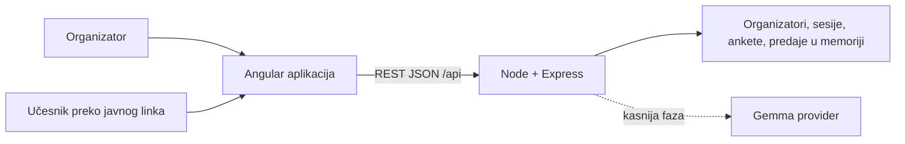

# Implementation Plan: Gemify feedback prototip

**Branch:** `001-event-feedback` | **Date:** 2026-10-10 | **Spec:** [spec.md](spec.md)
**Input:** `plan-hakaton/spec.md`
**Status:** tehnički nacrt za odobrenje, nije nalog za implementaciju.

## Summary

Angular SPA za dva korisnička toka, Node/Express REST API i memorijske strukture u jednom procesu. Backend je jedini izvor podataka o organizatorima, sesijama, anketama i predajama. Javna forma ne zahteva nalog. Organizatorske rute proveravaju sesiju i vlasništvo.

U prvoj fazi „Sumiraj” poziva samo frontend handler koji prikazuje obaveštenje. Backend interfejs za Gemmu i buduća ruta dokumentovani su u ugovoru, ali se sada ne implementiraju.

## Technical Context

| Stavka | Predlog |
| --- | --- |
| Frontend | Angular 21 LTS, TypeScript 5.9, standalone komponente, Router, HttpClient |
| Backend | Node.js 24 LTS, Express 5, TypeScript |
| Obrasci | Angular Reactive Forms i FormArray; bez dodatnog form-builder sistema |
| Stilovi | SCSS, jednostavan zajednički skup polja, dugmadi, kartica i poruka |
| Čuvanje | Map strukture u jednom Node procesu |
| Prijava | Nasumični neprozirni session token, server-side memorijska sesija |
| Prototipske lozinke | Običan string u memoriji, prema izričitom zahtevu |
| Testiranje | Testovi validacije/API-ja sa Vitest + Supertest; jedan glavni Playwright tok |
| Okruženje | Windows razvoj, savremeni desktop i mobilni pregledači |
| Obim za proveru | 10 anketa × 200 predaja; do 30 pitanja u jednoj anketi |
| Verzije | Tačne patch verzije i test zavisnosti proveriti i zaključati pri implementaciji |

Frontend sesijski token čuva u `sessionStorage`, pa osvežavanje stranice čuva prijavu u istom tabu. Backend sesija traje do odjave, restarta ili isteka posle 24 sata. Token se šalje samo na privatne API pozive, ne u javne linkove. Lozinka i token nisu deo odgovora koji prikazuju profil ili ankete. Nema dodatnog šifrovanja ili hashovanja lozinki u ovom prototipu; to je ograničenje demo verzije.

## Constitution Check

`.specify/memory/constitution.md` trenutno sadrži nepopunjen šablon. Ne tretiramo njegove primere kao usvojena pravila niti tvrdimo da je formalna provera ustava prošla. Izrada nacrta nastavlja se prema izričitom zahtevu korisnika; pre implementacije tim usvaja pravila ili potvrđuje ograničenja iz ovog plana.

Provere prema korisničkom zahtevu, pre i posle projektovanja:

- Angular frontend i Node backend: ispunjeno u predlogu.
- Podaci samo u backend memoriji: ispunjeno; bez baze i disk persistencije.
- Učesnik nema nalog; mejl se prikuplja: ispunjeno uz vidljivo pitanje anonimnosti.
- Organizator vidi sopstvene ankete i odgovore: ispunjeno.
- AI poziv odložen: ispunjeno; samo UI mesto za buduću funkciju.
- Dokumentacija pre implementacije: ispunjeno.
- Odobrenje tima i tri radne odluke: još otvoreno.

## Arhitektura



Backend slojevi: ruta → validacija i autentifikacija → servis → memorijski store. Mali servisni moduli odvajaju pravila od Express handlera. Nema generičkog repository frameworka, redova poslova, WebSocket-a ni mikroservisa.

Razvoj: Angular proxy prosleđuje `/api` na lokalni backend. Deljeni link koristi konfigurisani `PUBLIC_APP_URL`, odnosno frontend adresu. Za demo drugim uređajima to mora biti dostupna LAN/hostovana adresa, a ne `localhost`. Produkcionu infrastrukturu i javni deployment ne postavljamo u ovoj fazi.

## Ekrani i rute

| Ruta | Sadržaj i ponašanje |
| --- | --- |
| `/` | Preusmeravanje na `/surveys` ili `/login` prema prijavi |
| `/register` | Korisničko ime, mejl, lozinka, potvrda lozinke; potvrda se proverava samo u UI-ju |
| `/login` | Mejl i lozinka; link ka registraciji |
| `/surveys` | „Moje ankete”, naslov, datum, status, broj odgovora, nova anketa, odjava |
| `/surveys/new` | Editor novog nacrta |
| `/surveys/:id/edit` | Izmena nacrta; objavljena anketa vodi na detalje |
| `/surveys/:id` | Naslov/opis, pitanja, javni link, broj i lista predaja, „Sumiraj” |
| `/s/:publicToken` | Javna forma sa mejlom, pitanjima i dugmetom „Pošalji feedback” |

Potvrda predaje je stanje javne forme, bez nove rute. Odgovore organizator može da otvara kroz proširive kartice; najnoviji su prvi. U prvom obimu ne treba poseban ekran za svaki pojedinačni odgovor.

Editor ima „Dodaj tekstualno pitanje”, „Dodaj checkbox pitanje”, oznaku „Obavezno”, dodavanje/uklanjanje opcija i uklanjanje pitanja. Redosled je redosled u editoru; drag-and-drop nije potreban. „Sačuvaj nacrt” i „Generiši link” su odvojene akcije. Ako postoje nesačuvane izmene, objavljivanje prvo uspešno čuva ceo nacrt, zatim generiše link. Greška čuvanja sprečava objavljivanje.

## Project Structure

### Documentation

```text
plan-hakaton/
├── README.md
├── spec.md
├── plan.md
├── research.md
├── data-model.md
├── quickstart.md
├── contracts/api.md
└── checklists/requirements.md
```

`tasks.md` se generiše tek posle odobrenja.

### Source Code — predlog buduće strukture

```text
frontend/
  src/app/
    core/          # auth servis, interceptor, guard, API klijent
    shared/        # zajednička polja, poruke, renderer pitanja
    features/
      auth/
      surveys/     # lista, editor, detalji i odgovori
      public-survey/
backend/
  src/
    app.ts
    server.ts
    auth/
    surveys/
    responses/
    store/         # memorijske mape i pomoćni indeksi
    middleware/
    types/
  tests/
e2e/
plan-hakaton/
```

Svaki deo ima svoj `package.json`; bez dodatnog monorepo alata. Budući `backend/src/summaries/` dodajemo tek u AI fazi. Trenutno nijedan navedeni izvorni folder nije implementiran.

## Redosled implementacije posle odobrenja

| Korak | Rezultat | Provera izlaza |
| --- | --- | --- |
| 1. Osnova | Angular i Express projekti, proxy, zajednički format grešaka, health ruta | Frontend čita health odgovor backenda |
| 2. Nalozi | Memorijski organizatori i sesije, registracija/prijava/odjava, auth guard | Dva naloga; ispravna/pogrešna prijava; odjava |
| 3. Ankete | Editor, validacija, memorijske ankete, lista i objavljivanje | Kreiranje mešovite ankete i stabilan javni link |
| 4. Predaje | Javna forma, validacija na oba kraja, čuvanje i zaštita od ponovljenog zahteva | Gost popunjava; nevalidan zahtev se odbija |
| 5. Pregled | Lista predaja za vlasnika, prazna/error stanja, „Sumiraj” placeholder | Tačan broj i sadržaj; drugi organizator nema pristup |
| 6. Demo provera | Glavni E2E tok, mobilni prikaz, reset podataka | Scenariji iz quickstart-a prolaze |

Provera vlasništva i validacija ulaza dolaze sa pripadajućim rutama, a ne na kraju. Registrovanje i predaja ažuriraju sve povezane memorijske strukture zajedno, bez `await` između provere i upisa, da paralelni zahtevi ne zaobiđu jedinstvenost ili deduplikaciju.

## Buduća AI faza

Nakon završetka prvog prototipa tim bira konkretnu Gemma varijantu, način hostovanja i pristup inference servisu. Backend će za jednu svoju anketu sam učitati sve predaje i napraviti snapshot, ukloniti kontaktne podatke i proslediti ih `SummaryProvider` interfejsu.

Kaggle notebook treba da pokaže rad sa izabranim Gemma modelom nad sintetičkim feedbackom i dokumentuje nalaze. Ne pretpostavljamo da notebook već predstavlja stabilan API server. Velike skupove odgovora kasnije treba obrađivati u grupama bez tihog odbacivanja predaja. Ugovor i očekivani izlaz su u [contracts/api.md](contracts/api.md).

## Complexity Tracking

Najveća ograničenja su namerna: jedan proces, gubitak podataka pri restartu, prototipske lozinke, bez korisničkog identiteta učesnika i bez AI-ja u prvoj fazi. Osim radnih odluka u README-u, dodatna infrastruktura nije potrebna za ovaj obim.
